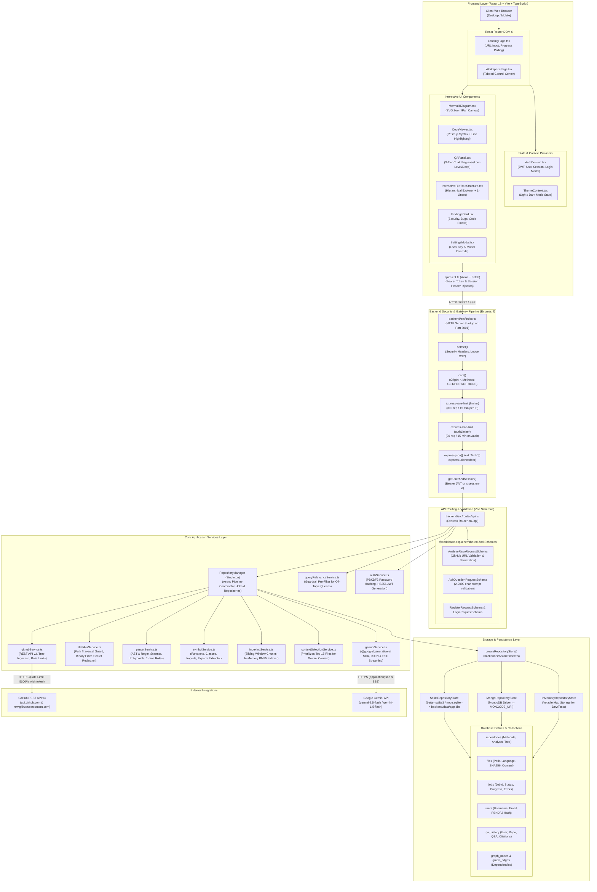
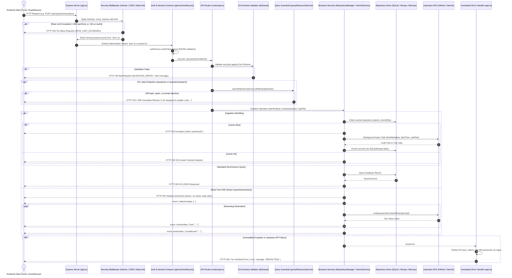
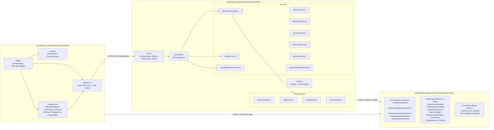

# Codebase Explainer AI — Comprehensive System Architecture Specification

> **Project Name**: Codebase Explainer AI (Code Apex)  
> **Repository**: `apexhackathon`  
> **Architecture Pattern**: Monorepo with Shared Type Contracts (npm workspaces: `shared/`, `backend/`, `frontend/`)  
> **Last Updated**: October 2026  
> **Status**: Verified Against Actual Source Code  

---

## 1. Executive Architectural Summary

The system is a production-grade full-stack developer tool engineered to ingest, parse, index, visualize, and explain unfamiliar software repositories using Google Gemini AI, rule-based AST analysis, and grounded in-memory BM25 retrieval.

Unlike simple request-response models (`Client -> Express App -> Router -> Handler -> View -> Response`), Codebase Explainer AI executes an asynchronous, event-driven ingestion pipeline, a hybrid multi-store persistence architecture (SQLite / MongoDB / In-Memory), strict input/token guardrails, and real-time Server-Sent Events (SSE) streaming for grounded multi-perspective Q&A.

---

## 2. Diagram 1: System Overview Architecture

This diagram visualizes the end-to-end system topology across all tiers: client presentation, gateway security, backend routing, business services, local persistence engines, and external API integrations.

---

## 3. Diagram 2: Backend Request Lifecycle & Execution Pipeline

This diagram traces the precise path an HTTP request traverses from incoming socket connection through security middleware, route-level authorization, validation, service delegation, and sanitized error handling.

---

## 4. Diagram 3: AI Processing & Repository Ingestion Pipeline

This diagram shows the complete data-transformation lifecycle: downloading repositories, sandboxing, secret redaction, BM25 indexing, context budgeting, and Gemini AI prompt generation.

```mermaid
flowchart TD
    subgraph TRIGGER["1. Initiation Stage"]
        IN_URL["User submits GitHub URL\n(LandingPage.tsx)"]
        POST_REQ["POST /api/repositories/analyze\n(Body: { url, apiKey?, branch?, model? })"]
        DISPATCH["repositoryManager.startAnalysis()\n- Generates jobId\n- Creates AbortController\n- Returns HTTP 202 Accepted"]
    end

    subgraph INGESTION["2. GitHub Ingestion & Security Filter Stage"]
        PARSE_URL["githubService.parseRepoUrl()\n(Enforces host 'github.com', strips .git)"]
        FETCH_META["githubService.fetchMetadata()\n(Calls api.github.com/repos/owner/repo)"]
        FETCH_TREE["githubService.fetchTree()\n(Recursive Git Tree via git/trees/:branch?recursive=1)"]
        
        subgraph FILTER_RULES["fileFilterService.shouldIncludeFile()"]
            RULE_TRAV["Block Path Traversal (../)"]
            RULE_DIRS["Exclude node_modules, .git, dist, venv, vendor"]
            RULE_BINS["Exclude binary files (.png, .zip, .exe, .wasm)"]
            RULE_SECRETS["Exclude secret files (.env, .pem, id_rsa)"]
            RULE_SIZE["Exclude files > 300KB (MAX_FILE_SIZE_BYTES)"]
            RULE_CAP["Cap candidate files at 500 (MAX_REPO_FILES)"]
        end
        
        BATCH_DOWNLOAD["githubService.fetchRawFile()\n(Bounded concurrency queue: 6 parallel fetches)"]
        REDACT_SECRETS["fileFilterService.redactSecrets()\n(Scrubs Google AIza, AWS AKIA, GitHub ghp_/pat, DB URIs)"]
    end

    subgraph PARSING_INDEXING["3. Code Analysis & BM25 Indexing Stage"]
        DETECT_LANG["detectLanguage()\n(Maps file extension to syntax engine)"]
        PARSE_PROJECT["parserService.parseProject()\n(Reads package.json, requirements.txt, cargo.toml -> Tech Stack & Entrypoints)"]
        PARSE_CONTENT["parserService.analyzeFileContent()\n(Extracts imports, exports, functions, 1-line responsibility)"]
        EXTRACT_SYMBOLS["symbolService.extractSymbols()\n(Extracts classes, interfaces, symbols for graph)"]
        BUILD_TREE["repositoryManager.buildTree()\n(Constructs hierarchical folder/file tree node structure)"]
        
        subgraph BM25_ENGINE["indexingService.ts (BM25 Engine)"]
            CHUNKER["chunkingService.ts\n(Sliding window: 120 lines, 20 line overlap)"]
            INVERTED_INDEX["Build Inverted Token Index\n(Tokenize, strip stop words, compute TF-IDF)"]
            BOOST_LOGIC["File Path Match 3x Boost Weighting"]
        end
    end

    subgraph AI_PIPELINE["4. Architecture Blueprint & Findings Generation"]
        CTX_SELECT["contextSelectionService.selectArchitectureContext()\n- Prioritizes entrypoints, manifests, core services\n- Slices top 15 files, truncates to 4000 chars\n- Formats manifest & paths list"]
        
        subgraph PROMPT_BUILDER["geminiService.generateRepositoryAnalysis()"]
            PROMPT_SCHEMA["Enforces JSON Schema Output\n- overview: { projectName, problemSolved, quickStart }\n- architecture: { pattern, layers, mermaidDiagram }\n- executionFlows: [{ name, trigger, steps }]\n- findings: [{ category, severity, remediation }]"]
            MODEL_INVOKE["model.generateContent()\n(gemini-2.5-flash / fallback to gemini-1.5-flash)\ntemperature: 0.2, responseMimeType: 'application/json'"]
        end
        
        FALLBACK_ANALYSIS["Rule-Based Fallback Generator\n(Used if Gemini is unconfigured or rate-limited)"]
    end

    subgraph PERSIST_COMPLETE["5. Persistence & Delivery Stage"]
        SAVE_DB["repositoryStore.saveRepository() & saveFiles()\n(Writes metadata, tree, analysis, files to SQLite/Mongo)"]
        JOB_COMPLETE["Job status -> 'completed' (100%)\n(Polling frontend navigates to /workspace/:owner/:repo)"]
    end

    %% Connections
    IN_URL --> POST_REQ --> DISPATCH
    DISPATCH --> PARSE_URL --> FETCH_META --> FETCH_TREE
    FETCH_TREE --> FILTER_RULES --> BATCH_DOWNLOAD --> REDACT_SECRETS
    REDACT_SECRETS --> DETECT_LANG
    DETECT_LANG --> PARSE_PROJECT
    DETECT_LANG --> PARSE_CONTENT
    DETECT_LANG --> EXTRACT_SYMBOLS
    PARSE_CONTENT --> BUILD_TREE
    REDACT_SECRETS --> CHUNKER --> INVERTED_INDEX --> BOOST_LOGIC
    
    BUILD_TREE --> CTX_SELECT
    PARSE_PROJECT --> CTX_SELECT
    CTX_SELECT --> PROMPT_BUILDER
    PROMPT_BUILDER --> MODEL_INVOKE
    MODEL_INVOKE -- "On Model Error" --> FALLBACK_ANALYSIS
    MODEL_INVOKE -- "On Success" --> SAVE_DB
    FALLBACK_ANALYSIS --> SAVE_DB
    SAVE_DB --> JOB_COMPLETE
```

---

## 5. Diagram 4: Data & External Integration Architecture

This diagram details the database schema entities, relationship constraints, storage implementations, and external third-party communication paths.

```mermaid
erDiagram
    %% ==========================================
    %% DATABASE ENTITIES (SQLite / MongoDB)
    %% ==========================================
    repositories ||--o{ files : "contains"
    repositories ||--o{ graph_nodes : "owns"
    repositories ||--o{ graph_edges : "owns"
    repositories ||--o{ symbols : "defines"
    repositories ||--o{ verifier_results : "evaluated_by"
    users ||--o{ user_repositories : "bookmarks"
    users ||--o{ qa_history : "asks"
    repositories ||--o{ qa_history : "referenced_in"

    repositories {
        string repo_id PK "e.g. 'expressjs/express'"
        string commit_sha PK "Git Commit SHA or HEAD"
        text metadata "JSON: name, stars, language, license"
        text analysis "JSON: overview, architecture, findings"
        text file_tree "JSON: Hierarchical file tree structure"
        text file_analysis_map "JSON: Map of 1-line responsibilities"
        string ingested_at "ISO-8601 Timestamp"
        string last_accessed_at "ISO-8601 Timestamp for LRU"
    }

    files {
        string repo_id PK,FK "References repositories.repo_id"
        string commit_sha PK,FK "References repositories.commit_sha"
        string path PK "Normalized relative path"
        string language "Detected language (typescript, python)"
        integer size "File size in bytes"
        integer line_count "Total lines"
        string sha256 "Content integrity hash"
        text content "Redacted source code text"
    }

    jobs {
        string job_id PK "job_1729000000_abc123"
        string repo_id "owner/repo"
        string url "Target GitHub repository URL"
        string status "validating | downloading | indexing | completed"
        text progress "JSON: percent, stage, warnings, error"
        string created_at "ISO-8601 Timestamp"
        string updated_at "ISO-8601 Timestamp"
    }

    graph_nodes {
        string id PK "Unique node identifier"
        string repo_id PK,FK "References repositories.repo_id"
        string commit_sha PK,FK "References repositories.commit_sha"
        string label "Display name of component"
        string kind "file | module | service | router | store"
        string file_path "Associated source file"
        text metadata "JSON: Extra metadata"
    }

    graph_edges {
        string id PK "Unique edge identifier"
        string repo_id PK,FK "References repositories.repo_id"
        string commit_sha PK,FK "References repositories.commit_sha"
        string source_id "Origin node ID"
        string target_id "Destination node ID"
        string kind "imports | calls | delegates | stores"
        string confidence "confirmed | inferred | unknown"
        text evidence "JSON: filePath, startLine, endLine"
    }

    symbols {
        string id PK "Symbol ID"
        string repo_id PK,FK "References repositories.repo_id"
        string commit_sha PK,FK "References repositories.commit_sha"
        string file_path "Associated source file"
        string name "Function / Class / Interface name"
        string kind "function | class | interface | variable"
        integer start_line "Definition start line"
        integer end_line "Definition end line"
    }

    users {
        string id PK "usr_uuidv4"
        string username UK "Unique alphanumeric handle"
        string email UK "Unique email address"
        string password_hash "PBKDF2 salted password hash"
        string created_at "ISO-8601 Timestamp"
        string last_login_at "ISO-8601 Timestamp"
    }

    qa_history {
        string id PK "qa_uuidv4"
        string repo_id FK "References repositories.repo_id"
        string user_id FK "Optional reference to users.id"
        string session_id "Anonymous cookie/header session UUID"
        text question "User prompt text"
        text answer "Markdown response text"
        text citations "JSON: [{ filePath, startLine, endLine }]"
        string model_used "gemini-2.5-flash / fallback"
        string created_at "ISO-8601 Timestamp"
    }

    user_repositories {
        string id PK "userId_repoId composite"
        string user_id FK "References users.id"
        string repo_id FK "References repositories.repo_id"
        string last_viewed_at "ISO-8601 Timestamp"
    }
```

---

## 6. Diagram 5: Workspace Monorepo Module Dependencies

This diagram maps code dependencies, internal exports, and package boundary constraints across the npm workspaces.

---

## 7. Comprehensive Explanation of Architectural Layers

### Layer 1: Client and Frontend Layer
* **Runtime & Bundler**: React 18, Vite 5, TypeScript 5, Tailwind CSS.
* **Component Architecture**:
  * [LandingPage.tsx](file:///c:/Users/ajink/OneDrive/Desktop/project/apex%203.0/apexhackathon/frontend/src/pages/LandingPage.tsx): Repository entry point, branch toggle, sample repository cards, and real-time ingestion progress monitoring via `setInterval` polling every 1200ms.
  * [WorkspacePage.tsx](file:///c:/Users/ajink/OneDrive/Desktop/project/apex%203.0/apexhackathon/frontend/src/pages/WorkspacePage.tsx): Primary 3-panel workspace dashboard. Manages left sidebar (resizable 180–450px), middle content canvas, and right Q&A drawer (resizable 260–600px).
  * [MermaidDiagram.tsx](file:///c:/Users/ajink/OneDrive/Desktop/project/apex%203.0/apexhackathon/frontend/src/components/MermaidDiagram.tsx): Client-side SVG renderer using Mermaid.js with hardware-accelerated pan, dynamic zoom ($0.5\times$ to $2.0\times$), reset controls, and copy buttons.
  * [CodeViewer.tsx](file:///c:/Users/ajink/OneDrive/Desktop/project/apex%203.0/apexhackathon/frontend/src/components/CodeViewer.tsx): Integrated syntax highlighter using Prism.js with line numbers, active line range highlighting, and smooth automatic scroll centering.
  * [QAPanel.tsx](file:///c:/Users/ajink/OneDrive/Desktop/project/apex%203.0/apexhackathon/frontend/src/components/QAPanel.tsx): Multi-tier AI chat drawer supporting real-time Server-Sent Events (SSE) token streaming, markdown rendering, and jumpable citation chips.

### Layer 2: Server Initialization & Lifecycle
* **Entry Point**: [backend/src/index.ts](file:///c:/Users/ajink/OneDrive/Desktop/project/apex%203.0/apexhackathon/backend/src/index.ts) initializes the Express app via `createApp()` and binds to `config.PORT` (3001) and `config.HOST` (`0.0.0.0`).
* **Configuration**: [backend/src/config.ts](file:///c:/Users/ajink/OneDrive/Desktop/project/apex%203.0/apexhackathon/backend/src/config.ts) loads root `.env` via `dotenv`, validates settings using Zod `EnvSchema`, and exposes `getConfigSummary()` which sanitizes secrets before returning status flags.

### Layer 3: Middleware Pipeline
The middleware pipeline executes strictly in the following sequential order in [backend/src/app.ts](file:///c:/Users/ajink/OneDrive/Desktop/project/apex%203.0/apexhackathon/backend/src/app.ts):
1. `helmet()`: Applies hardened HTTP response headers (disables rigid CSP to allow dynamic inline SVG Mermaid rendering).
2. `cors()`: Handles cross-origin requests from the Vite dev server and web clients (`origin: '*'`, methods: `GET, POST, OPTIONS`).
3. `rateLimit(limiter)`: General API protection limiting all `/api/*` traffic to 300 requests per 15 minutes per IP.
4. `rateLimit(authLimiter)`: Stricter brute-force protection on `/api/auth/login` and `/api/auth/register` (30 attempts per 15 minutes per IP).
5. `express.json({ limit: '5mb' })` & `express.urlencoded({ extended: true, limit: '5mb' })`: Parses incoming JSON request payloads with explicit payload caps to prevent DoS.
6. `express.static()`: Serves production frontend build artifacts if `frontend/dist` exists.
7. `Centralized Error Handler`: Intercepts unhandled errors, status codes $\ge 400$, and redacts API keys, tokens, and DB passwords via regular expressions.

### Layer 4: API Routing & Controllers
All REST endpoints are registered in [backend/src/routes/api.ts](file:///c:/Users/ajink/OneDrive/Desktop/project/apex%203.0/apexhackathon/backend/src/routes/api.ts) under the `/api` prefix:
* **Health**: `GET /api/health`
* **Authentication**: `POST /api/auth/register`, `POST /api/auth/login`, `GET /api/auth/me`
* **Ingestion Management**: `POST /api/repositories/analyze`, `GET /api/jobs/:jobId`, `POST /api/jobs/:jobId/cancel`
* **Repository Data**: `GET /api/repositories`, `GET /api/repositories/:owner/:repo`, `GET /api/repositories/:owner/:repo/files`, `GET /api/repositories/:owner/:repo/files/content`, `GET /api/repositories/:owner/:repo/analysis`
* **Q&A Engine**: `POST /api/repositories/:owner/:repo/questions` (Standard JSON), `POST /api/repositories/:owner/:repo/questions/stream` (SSE Stream), `GET /api/repositories/:owner/:repo/questions/history`

### Layer 5: Service & Business Logic
* [repositoryManager.ts](file:///c:/Users/ajink/OneDrive/Desktop/project/apex%203.0/apexhackathon/backend/src/services/repositoryManager.ts): Singleton orchestrator managing background ingestion promises, `AbortController` job cancellations, in-memory cache, and fallback generation.
* [githubService.ts](file:///c:/Users/ajink/OneDrive/Desktop/project/apex%203.0/apexhackathon/backend/src/services/githubService.ts): Validates URLs, fetches repository trees and metadata from GitHub REST API v3, downloads raw file contents in concurrent batches of 6, and inspects GitHub rate-limit headers.
* [fileFilterService.ts](file:///c:/Users/ajink/OneDrive/Desktop/project/apex%203.0/apexhackathon/backend/src/services/fileFilterService.ts): Sandboxes file trees by blocking path traversal (`../`), excluding non-code binary assets, vendor folders, build outputs, and redacting secret patterns before persistence.
* [parserService.ts](file:///c:/Users/ajink/OneDrive/Desktop/project/apex%203.0/apexhackathon/backend/src/services/parserService.ts): Parses project manifests (`package.json`, `requirements.txt`, etc.) to detect runtimes, frameworks, and test runners; parses individual source files to extract imports, exports, functions, and 1-line summary responsibilities.
* [symbolService.ts](file:///c:/Users/ajink/OneDrive/Desktop/project/apex%203.0/apexhackathon/backend/src/services/symbolService.ts): Performs AST and regex token extraction to index symbols, functions, and interfaces for structural dependency graphs.
* [authService.ts](file:///c:/Users/ajink/OneDrive/Desktop/project/apex%203.0/apexhackathon/backend/src/services/authService.ts): Handles PBKDF2 password hashing (10,000 iterations, 64-byte salt) and generates/verifies HMAC-SHA256 JWT tokens.

### Layer 6: AI Processing & Agent Architecture
* [geminiService.ts](file:///c:/Users/ajink/OneDrive/Desktop/project/apex%203.0/apexhackathon/backend/src/services/geminiService.ts): Integrates with Google Generative AI SDK (`@google/generative-ai`).
  * **Structured Analysis**: Uses low temperature ($0.2$) with `responseMimeType: 'application/json'` to generate structured architecture summaries, Mermaid diagrams, execution flows, and findings cards.
  * **Interactive Q&A**: Constructs grounded prompts with retrieved code snippets, producing 3 synchronized tiers (🟢 Beginner, 🟡 Low-Level Technical, 🟣 Deep Implementation).
  * **Streaming Support**: Emits real-time tokens over Server-Sent Events (`text/event-stream`).
  * **Automated Fallback**: Automatically cascades to `gemini-1.5-flash` or deterministic rule-based analysis if the primary model is throttled or missing an API key.
* [indexingService.ts](file:///c:/Users/ajink/OneDrive/Desktop/project/apex%203.0/apexhackathon/backend/src/services/indexingService.ts): Sliding-window chunker ($120$ lines per chunk, $20$ lines overlap) and in-memory BM25 ranker with 3x filename boost.
* [queryRelevanceService.ts](file:///c:/Users/ajink/OneDrive/Desktop/project/apex%203.0/apexhackathon/backend/src/services/queryRelevanceService.ts): Intent classification guardrail intercepting off-topic queries, prompt injections, and generic small talk before calling Gemini.

### Layer 7: Data & Database Layer
* [backend/src/store/index.ts](file:///c:/Users/ajink/OneDrive/Desktop/project/apex%203.0/apexhackathon/backend/src/store/index.ts): Factory selecting the persistence backend:
  1. `SqliteRepositoryStore`: Default local disk persistence (`backend/data/app.db`) using Node 22 built-in `node:sqlite` or `better-sqlite3`. Contains automated schema migration versions 1 and 2 with foreign keys and compound indexes.
  2. `MongoRepositoryStore`: Document-based persistent storage when `MONGODB_URI` is provided in environment variables.
  3. `InMemoryRepositoryStore`: Fast in-memory map store used during unit testing and development fallback.

### Layer 8: External Integrations
* **GitHub REST API v3**: `https://api.github.com` and `https://raw.githubusercontent.com`. Used for repository metadata, recursive git trees, and raw file blobs. Authenticated with server-side `GITHUB_TOKEN` (up to 5,000 requests/hr).
* **Google Gemini API**: `https://generativelanguage.googleapis.com`. Invoked using official `@google/generative-ai` SDK (`gemini-2.5-flash` default).

### Layer 9: Security Boundaries & Secret Isolation
* **Zero Secrets to Frontend**: Backend environment variables (`GEMINI_API_KEY`, `GITHUB_TOKEN`, `AUTH_SECRET`, `MONGODB_URI`) are never sent to the browser.
* **Client Key Isolation**: User-provided API keys in Settings are stored only in client `localStorage`, transmitted in-flight via HTTP headers (`x-gemini-api-key`), used in-memory, and never written to server disk or logs.
* **Code Redaction**: All ingested source code passes through `redactSecrets()` before reaching the database, chunk indexer, or LLM prompts.
* **Error Scrubbing**: Global error handler strips API keys (`AIza...`), GitHub tokens (`ghp_...`, `github_pat_...`), AWS keys, and connection strings from error messages.

---

## 8. Source File Mapping Table

| Diagram Component | Architectural Role | Actual Source File |
| :--- | :--- | :--- |
| **`UI_BROWSER`** | Client Presentation | [frontend/index.html](file:///c:/Users/ajink/OneDrive/Desktop/project/apex%203.0/apexhackathon/frontend/index.html) |
| **`PAGE_LANDING`** | URL Entry & Polling | [frontend/src/pages/LandingPage.tsx](file:///c:/Users/ajink/OneDrive/Desktop/project/apex%203.0/apexhackathon/frontend/src/pages/LandingPage.tsx) |
| **`PAGE_WORKSPACE`** | 3-Panel Workspace Shell | [frontend/src/pages/WorkspacePage.tsx](file:///c:/Users/ajink/OneDrive/Desktop/project/apex%203.0/apexhackathon/frontend/src/pages/WorkspacePage.tsx) |
| **`COMP_MERMAID`** | Architecture SVG Visualizer | [frontend/src/components/MermaidDiagram.tsx](file:///c:/Users/ajink/OneDrive/Desktop/project/apex%203.0/apexhackathon/frontend/src/components/MermaidDiagram.tsx) |
| **`COMP_CODE`** | Syntax & Citation Viewer | [frontend/src/components/CodeViewer.tsx](file:///c:/Users/ajink/OneDrive/Desktop/project/apex%203.0/apexhackathon/frontend/src/components/CodeViewer.tsx) |
| **`COMP_QA`** | 3-Perspective Q&A Drawer | [frontend/src/components/QAPanel.tsx](file:///c:/Users/ajink/OneDrive/Desktop/project/apex%203.0/apexhackathon/frontend/src/components/QAPanel.tsx) |
| **`API_CLIENT`** | Frontend HTTP / SSE Client | [frontend/src/api/client.ts](file:///c:/Users/ajink/OneDrive/Desktop/project/apex%203.0/apexhackathon/frontend/src/api/client.ts) |
| **`SRV_INDEX`** | Backend Server Entrypoint | [backend/src/index.ts](file:///c:/Users/ajink/OneDrive/Desktop/project/apex%203.0/apexhackathon/backend/src/index.ts) |
| **`B_APP`** | Express App & Security Stack | [backend/src/app.ts](file:///c:/Users/ajink/OneDrive/Desktop/project/apex%203.0/apexhackathon/backend/src/app.ts) |
| **`ROUTER_API`** | API Routing & Validation | [backend/src/routes/api.ts](file:///c:/Users/ajink/OneDrive/Desktop/project/apex%203.0/apexhackathon/backend/src/routes/api.ts) |
| **`SCHEMAS`** | Shared Zod Schemas & Types | [shared/src/index.ts](file:///c:/Users/ajink/OneDrive/Desktop/project/apex%203.0/apexhackathon/shared/src/index.ts) |
| **`MGR_REPO`** | Ingestion & Job Coordinator | [backend/src/services/repositoryManager.ts](file:///c:/Users/ajink/OneDrive/Desktop/project/apex%203.0/apexhackathon/backend/src/services/repositoryManager.ts) |
| **`SVC_GITHUB`** | GitHub API Integration | [backend/src/services/githubService.ts](file:///c:/Users/ajink/OneDrive/Desktop/project/apex%203.0/apexhackathon/backend/src/services/githubService.ts) |
| **`SVC_FILTER`** | Security Sandboxing & Redaction | [backend/src/services/fileFilterService.ts](file:///c:/Users/ajink/OneDrive/Desktop/project/apex%203.0/apexhackathon/backend/src/services/fileFilterService.ts) |
| **`SVC_PARSER`** | AST & Manifest Parser | [backend/src/services/parserService.ts](file:///c:/Users/ajink/OneDrive/Desktop/project/apex%203.0/apexhackathon/backend/src/services/parserService.ts) |
| **`SVC_SYMBOL`** | Structural Symbol Extractor | [backend/src/services/symbolService.ts](file:///c:/Users/ajink/OneDrive/Desktop/project/apex%203.0/apexhackathon/backend/src/services/symbolService.ts) |
| **`SVC_INDEX`** | Sliding Chunker & BM25 Ranker | [backend/src/services/indexingService.ts](file:///c:/Users/ajink/OneDrive/Desktop/project/apex%203.0/apexhackathon/backend/src/services/indexingService.ts) |
| **`SVC_RELEVANCE`** | Intent & Guardrail Filter | [backend/src/services/queryRelevanceService.ts](file:///c:/Users/ajink/OneDrive/Desktop/project/apex%203.0/apexhackathon/backend/src/services/queryRelevanceService.ts) |
| **`SVC_CONTEXT`** | Context Budgeting & Selection | [backend/src/services/contextSelectionService.ts](file:///c:/Users/ajink/OneDrive/Desktop/project/apex%203.0/apexhackathon/backend/src/services/contextSelectionService.ts) |
| **`SVC_GEMINI`** | Google Gemini SDK Wrapper | [backend/src/services/geminiService.ts](file:///c:/Users/ajink/OneDrive/Desktop/project/apex%203.0/apexhackathon/backend/src/services/geminiService.ts) |
| **`SVC_AUTH`** | PBKDF2 & JWT Auth Engine | [backend/src/services/authService.ts](file:///c:/Users/ajink/OneDrive/Desktop/project/apex%203.0/apexhackathon/backend/src/services/authService.ts) |
| **`STORE_SQLITE`** | SQLite Relational Persistence | [backend/src/store/sqliteStore.ts](file:///c:/Users/ajink/OneDrive/Desktop/project/apex%203.0/apexhackathon/backend/src/store/sqliteStore.ts) |
| **`STORE_MONGO`** | MongoDB Document Persistence | [backend/src/store/mongoStore.ts](file:///c:/Users/ajink/OneDrive/Desktop/project/apex%203.0/apexhackathon/backend/src/store/mongoStore.ts) |
| **`STORE_MEMORY`** | RAM Fallback / Test Store | [backend/src/store/memoryStore.ts](file:///c:/Users/ajink/OneDrive/Desktop/project/apex%203.0/apexhackathon/backend/src/store/memoryStore.ts) |

---

## 9. Verification & Audit of Grounded Relationships

* **Verified Against Source Code**:
  - Every single service, store implementation, router endpoint, middleware, and React component documented above exists in the repository with matching filenames, line references, and interface methods.
  - No synthetic or imaginary agents, databases, or frameworks were included.
* **Inferred / Optional Implementations**:
  - `MongoRepositoryStore`: Fully implemented in code (`backend/src/store/mongoStore.ts`) but only activated when `MONGODB_URI` is supplied in environment variables; otherwise, the application defaults to `SqliteRepositoryStore` writing to `backend/data/app.db`.
  - Frontend production serving via `express.static()`: Configured in `backend/src/app.ts` (lines 60–66) for monorepo single-container deployment, but bypassed in local development when running Vite on port 5173.
